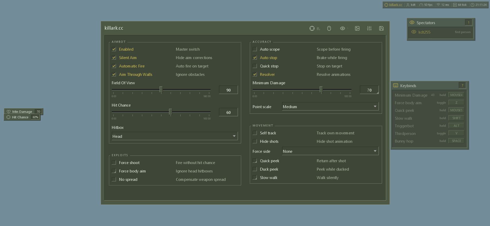
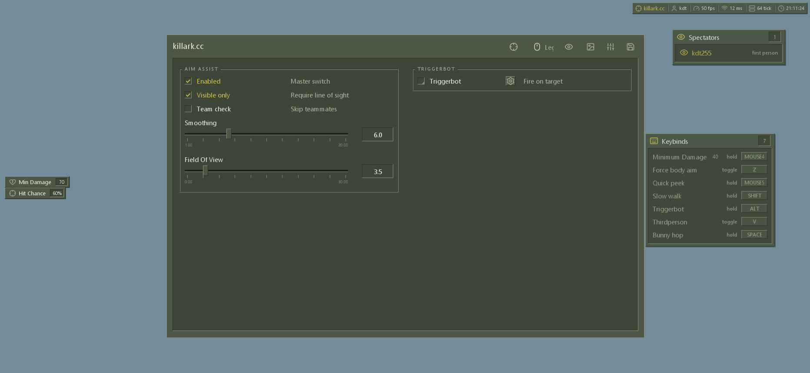
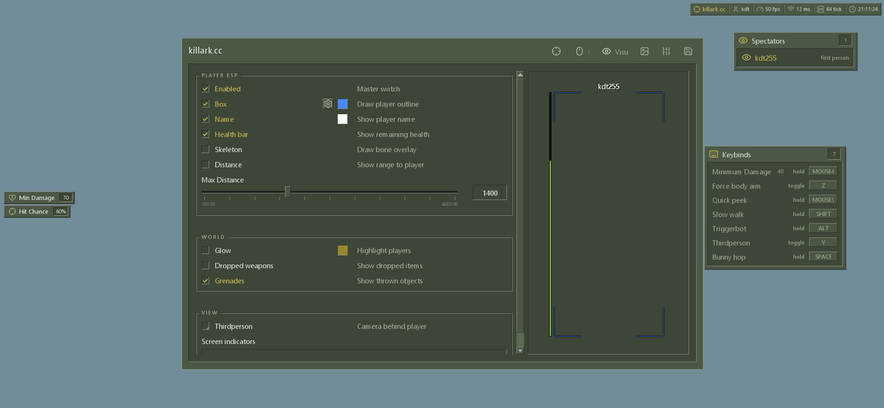
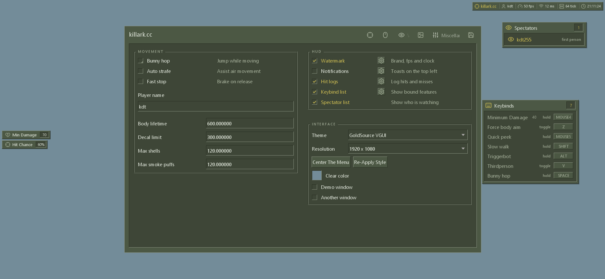

# Valve Graphical User Interface (VGUI)

> **Font licensing note:** The original embedded font was Tahoma, a Microsoft font supplied with Windows. Its font data is not included in this repository because the standard Windows font license does not permit redistributing the font files. This sample uses the locally installed Segoe UI font when available, with Dear ImGui's built-in font as a fallback. Obtain separate redistribution rights before bundling Tahoma.

A Dear ImGui 1.92.9b Windows/Direct3D 11 sample featuring a GoldSrc-inspired **Valve Graphical User Interface (VGUI)** and custom widgets.

## Features

- GoldSrc-style theme, menu tabs, and responsive layout
- Custom checkbox, color picker, multi-select, keybind capture, and context bind controls
- Spectator and keybind list overlays, indicators, watermark, notifications, and hit/miss log examples
- ESP preview with configurable box, health, name, glow, and distance overlays
- Lucide icons and Win32 + Direct3D 11 backends with FreeType support

## Screenshots

| Screen | Preview |
| --- | --- |
| Aim controls and sliders |  |
| Legit controls |  |
| ESP preview without a character model |  |
| HUD, spectator list, and keybind list |  |

## Build

Open `examples/example_win32_directx11/example_win32_directx11.vcxproj` in Visual Studio and build `Release | x64`.

The project uses C++17, the Windows 10 SDK, Direct3D 11, and the bundled FreeType static library. Select a Visual Studio platform toolset installed on your machine if `v141` is unavailable.

Run `examples/example_win32_directx11/Release/example_win32_directx11.exe`. Press **Insert** to show or hide the menu.

## Repository layout

- `examples/example_win32_directx11/vgui/` — VGUI menu, widgets, overlays, and licensed Lucide font source
- `backends/` — Win32 and Direct3D 11 backends
- `misc/freetype/`, `thirdparty/freetype/` — FreeType integration and libraries
- `screenshots/` — UI captures

## Fonts and licenses

Dear ImGui and this project retain the MIT license in [`LICENSE.txt`](LICENSE.txt). The Lucide font license is included alongside its embedded font data in `examples/example_win32_directx11/vgui/embedded/`. The sample loads Segoe UI from the standard Windows fonts folder when available and falls back to Dear ImGui's built-in font. No Microsoft font files are redistributed.
